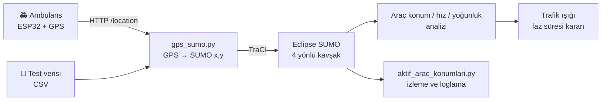

<div align="center">

# 🚑 Akıllı Kavşak — Ambulans Önceliği için SUMO + GPS Simülasyonu

**Ambulans konumunu (ESP32 GPS) trafik simülasyonuna taşıyan ve kavşak yoğunluğunu analiz eden TEKNOFEST Akıllı Ulaşım prototipi.**


</div>

---

## Amaç

Acil durum araçları (özellikle ambulanslar) kavşaklardaki yoğunluk ve trafik ışığı bekleme süreleri nedeniyle zaman kaybeder. Bu proje, bu sorunu **simülasyon ortamında** denemek için bir altyapı sunar:

1. Ambulanstaki **ESP32 + GPS modülünden** gelen konum verisi alınır.
2. Konum, **Eclipse SUMO** trafik simülasyonundaki bir araca dönüştürülür.
3. Simülasyondaki araç yoğunluğu ve hızlar kavşak bazında analiz edilir.
4. Bu veriyle trafik ışığı kararının nasıl verilebileceği test edilir.



## Proje durumu

Bu bir **prototiptir**. Neyin çalıştığı ve neyin henüz tamamlanmadığı açıkça şöyle:

| Bileşen | Durum | Açıklama |
|---|---|---|
| SUMO kavşak senaryosu, rota üretimi | ✅ Çalışıyor | `runner.py`, `data/` |
| İndüksiyon döngüsüyle ışık fazı değiştirme | ✅ Çalışıyor | `runner.py` (kuzeyden araç gelince doğu-batı yeşilini keser) |
| CSV'den GPS verisini simülasyona araç olarak ekleme | ✅ Çalışıyor | `gps_sumo.py`, test CSV dosyaları |
| ESP32'den HTTP ile canlı GPS okuma | 🟡 Kod hazır | `esp32_gps_al()`, donanımla uçtan uca doğrulanmadı |
| Yol bazlı yoğunluk ve ortalama hız analizi | ✅ Çalışıyor | `trafik_yogunlugu_analiz()` |
| Yoğunluğa göre faz süresi hesabı | 🟡 Kısmi | Süre hesaplanıp ekrana yazılıyor, ışık programına henüz uygulanmıyor |
| Ambulans algılandığında yeşil dalga / öncelik verme | 🔲 Planlandı | Sıradaki adım |
| GPS → SUMO koordinat dönüşümü | 🟡 Basit model | Sabit bir referans noktasına göre doğrusal ölçekleme, gerçek harita eşlemesi değil |

## Dosyalar

| Dosya | Görevi |
|---|---|
| [`runner.py`](runner.py) | SUMO'yu başlatır, rota dosyasını üretir, indüksiyon döngüsüne göre trafik ışığı fazını yönetir |
| [`gps_sumo.py`](gps_sumo.py) | GPS verisini (ESP32 veya CSV) SUMO koordinatına çevirir, araç ekler/günceller, yoğunluk analizi yapar |
| [`aktif_arac_konumlari.py`](aktif_arac_konumlari.py) | Simülasyondaki araçların konum, hız ve yollarını izler; `arac_konumlari.txt` dosyasına kaydeder |
| [`data/`](data) | SUMO ağ, kavşak, rota ve dedektör dosyaları (`cross.sumocfg` ana yapılandırma) |
| `*.csv` | Test senaryoları: tek araçlı ve çok araçlı GPS izleri |

## Kurulum

**Gereksinimler:** Python 3.8+ ve [Eclipse SUMO](https://sumo.dlr.de/docs/Downloads.php).

```bash
git clone https://github.com/ahmetkc58/teknofest_akilliulasim.git
cd teknofest_akilliulasim
pip install -r requirements.txt
```

`traci` kütüphanesi için `SUMO_HOME` ortam değişkeni tanımlı olmalıdır:

```bash
# macOS / Linux
export SUMO_HOME="/usr/share/sumo"          # kurulum yoluna göre değişir

# Windows (PowerShell)
$env:SUMO_HOME = "C:\Program Files (x86)\Eclipse\Sumo"
```

## Kullanım

### 1. Temel simülasyon ve dinamik ışık yönetimi

```bash
python runner.py            # SUMO-GUI ile
python runner.py --nogui    # arayüzsüz
```

Çıktı olarak `tripinfo.xml` üretilir (araç başına bekleme ve seyahat süreleri).

### 2. GPS verisini simülasyona dahil etme

```bash
python gps_sumo.py
```

Program iki veri kaynağı sunar:

- **ESP32:** `ESP32_IP` ortam değişkeniyle verilen adrese `GET /location` isteği atar
- **CSV:** `single_vehicle_test.csv`, `test_gps_data.csv`, `detailed_test_gps_data.csv`

```bash
ESP32_IP=192.168.1.50 python gps_sumo.py      # ESP32 adresini ver (varsayılan: 192.168.1.100)
```

### 3. Araçları izleme ve kaydetme

```bash
python aktif_arac_konumlari.py
```

Menü: tüm araçları izle · dosyaya kaydet (`arac_konumlari.txt`) · ID ile tek araç takibi.

## Yol haritası

- [ ] Ambulans yaklaşırken ilgili kavşakta yeşil dalga (öncelik) uygulaması
- [ ] Hesaplanan faz sürelerinin SUMO ışık programına yazılması
- [ ] GPS koordinatlarının gerçek harita (`net.xml` projeksiyonu) ile eşlenmesi
- [ ] Çoklu kavşak koordinasyonu
- [ ] `sistem_entegrasyonu.py` ile bileşenlerin tek akışta birleştirilmesi

## Teşekkür ve lisans notu

Kavşak senaryosu ve `runner.py`, [Eclipse SUMO](https://eclipse.dev/sumo/) projesinin TraCI öğreticisinden uyarlanmıştır. SUMO, Eclipse Public License 2.0 ile dağıtılır. Bu depodaki kendi kodlarım (`gps_sumo.py`, `aktif_arac_konumlari.py`) ve entegrasyon çalışması TEKNOFEST Akıllı Ulaşım yarışması kapsamında geliştirilmiştir.

---

<div align="center">

Geliştirici: **Ahmet Koç** · [GitHub](https://github.com/ahmetkc58) · [LinkedIn](https://linkedin.com/in/ahmetkoc) · [kocengineer.com](https://kocengineer.com)

</div>
